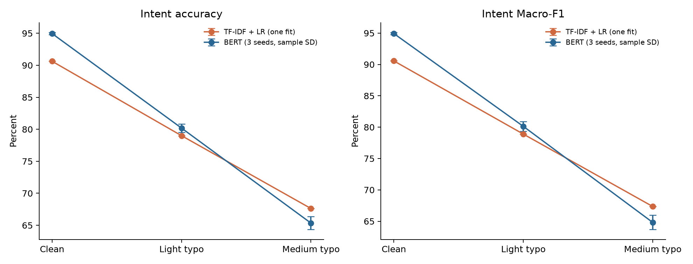
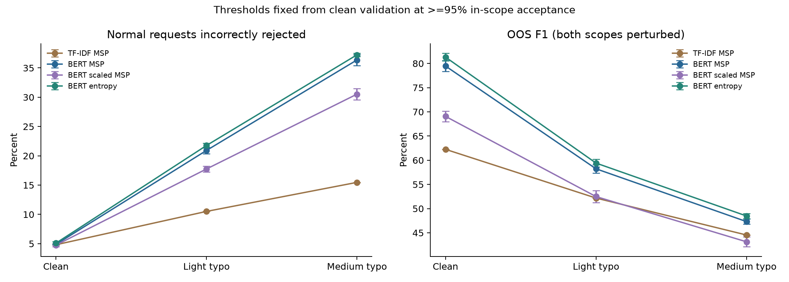
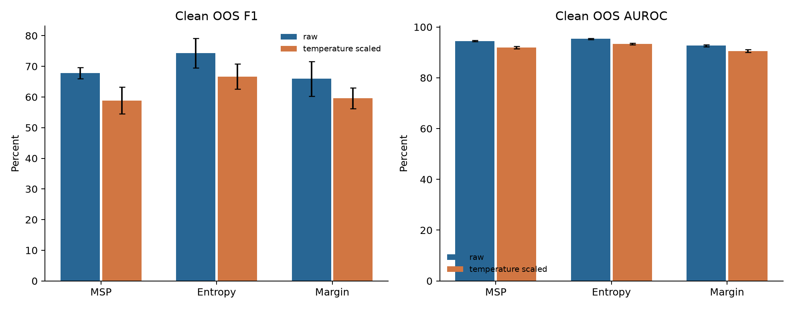

# 多 seed 验证与 typo 鲁棒性实验报告

日期：2026-10-19。以下数值由已核验的实验表自动生成。

## 1. 已完成的工作

- 复用 seed42，新增 seeds 43、44，共 3 次独立 BERT 训练，配置保持一致。
- 每个 seed 用干净 validation 选择 checkpoint、拟合温度、冻结拒识阈值。
- 完成 36 组 clean OOS 对照，以及 3 种文本条件下的分类和拒识评估。
- TF-IDF baseline 按历史选定的 C=4.0 重建，其 clean 分类结果与历史结果一致。
- 保存逐样本 typo、预测、logits、阈值、均值/样本标准差和独立核验结果。

表中“均值 ± 标准差”均以百分数展示，标准差单位为百分点，采用 3 个训练 seed 的样本标准差（ddof=1）。这不是置信区间。TF-IDF 只有一次固定拟合，不虚构多 seed 标准差。

## 2. 固定配置的多 seed 结果

BERT 使用 learning rate=2e-5、3 epochs、batch size=16、max length=64。这里完成的是固定配置稳定性验证，尚未完成原计划的超参数网格搜索。

| Seed | 最佳 epoch | Validation Macro-F1 | Test Accuracy | Test Macro-F1 |
|---:|---:|---:|---:|---:|
| 42 | 3 | 95.23% | 95.00% | 94.98% |
| 43 | 3 | 95.14% | 94.76% | 94.73% |
| 44 | 3 | 95.53% | 95.09% | 95.06% |

Test Accuracy：**94.95 ± 0.17**；Test Macro-F1：**94.92 ± 0.17**。

所有 seed 都参与统计，没有按 test 表现挑选 seed。

## 3. 校准结论的多 seed 验证

| Test 指标 | 原始 BERT | 温度缩放 |
|---|---:|---:|
| ECE，越低越好 | 35.59 ± 0.76 | 0.85 ± 0.24 |
| NLL，越低越好 | 0.6462 ± 0.0088 | 0.2234 ± 0.0080 |
| MSP OOS F1，validation F1 阈值 | 67.77 ± 1.84 | 58.87 ± 4.39 |

最后一行使用完整 test 的 OOS/IS 混合评估；前两行只计算 in-scope 样本。温度缩放保持最高概率类别不变，因此分类准确率不变。

| Seed | MSP OOS F1 校准后减校准前（百分点） |
|---:|---:|
| 42 | -2.79 |
| 43 | -8.73 |
| 44 | -15.15 |

三个 seed 的主对照均下降。概率校准质量与 OOS 检测是不同目标；应保留这一结果，不能用校准误差改善替代 OOS 改善的证据。3 个 seed 仍不足以覆盖所有训练配置。

采用干净 validation 正常请求接受率至少 95% 的规则时，原始 entropy 的 clean test 结果为：

- OOS F1：**81.31 ± 0.78**。
- OOS recall：**84.20 ± 0.82**。
- 正常请求接受率：**94.91 ± 0.26**。

95% 是 validation 约束，不能保证 test 或 typo 数据达到同一接受率。完整的 12 种 OOS 设置均保留在结果表中。

## 4. Typo 测试如何构建

对同一批 5,500 条 test 文本构建 clean/light/medium；包括 4,500 条正常输入和 1,000 条 OOS。随机种子固定为 2026，与模型无关。

只修改至少 5 个英文字母的词，保留词首/词尾。操作为删除一个内部字符，或交换两个不同的内部相邻字符。Light 最多修改 1 个词，medium 最多修改 2 个不同词，并包含 light 的同一处修改。

| 条件 | 正常文本实际改变 | OOS 文本实际改变 | 正常文本修改两个词 |
|---|---:|---:|---:|
| typo_light | 4144/4500（92.09%） | 984/1000（98.40%） | 0/4500 |
| typo_medium | 4144/4500（92.09%） | 984/1000（98.40%） | 3074/4500 |

没有合适词的文本保持原样；只有一个合适词时，两种扰动相同。全量结果保留这些样本，并补充只对可修改的正常样本计算的准确率。自动字符修改继承原标签，仍可能偶然形成其他有效单词，不能视作经过人工语义认证的改写测试。

## 5. Typo 对分类的影响

| 模型 | 条件 | Accuracy | Macro-F1 | Macro-F1 相对 clean 下降（百分点） | 可修改子集 Accuracy |
|---|---|---:|---:|---:|---:|
| TF-IDF + LR | clean | 90.62% | 90.56% | 0.00 | 90.66% |
| TF-IDF + LR | typo_light | 79.00% | 78.90% | 11.66 | 78.04% |
| TF-IDF + LR | typo_medium | 67.62% | 67.35% | 23.21 | 65.69% |
| BERT，3 seeds | clean | 94.95 ± 0.17 | 94.92 ± 0.17 | 0.00 | 94.80 ± 0.24 |
| BERT，3 seeds | typo_light | 80.19 ± 0.67 | 80.13 ± 0.78 | 14.79 | 78.77 ± 0.76 |
| BERT，3 seeds | typo_medium | 65.34 ± 1.01 | 64.81 ± 1.14 | 30.11 | 62.65 ± 1.13 |

温度缩放不会改变 argmax，校准前后分类性能相同；其影响主要体现在置信度和拒识。可修改子集固定为 4,144 条正常文本，clean/light/medium 在同一子集上比较。

BERT 的 clean Macro-F1 比 TF-IDF 高 4.36 个百分点；light 时领先缩小为 1.23 个百分点；medium 时则低于 TF-IDF 2.54 个百分点。BERT 的 clean 优势没有在较强拼写噪声下保持。该结论限于本次字符扰动、数据集与固定训练配置。

## 6. Typo 对拒识的影响

本表所有阈值均来自各模型的干净 validation，并采用“validation 正常接受率至少 95%”规则。Typo test 中的正常文本和 OOS 文本同时扰动。

| 系统 | 条件 | 正常输入误拒率 | OOS F1 | 正常输入正确且被接受比例 |
|---|---|---:|---:|---:|
| TF-IDF MSP | clean | 4.82% | 62.25% | 88.71% |
| TF-IDF MSP | typo_light | 10.51% | 52.18% | 75.20% |
| TF-IDF MSP | typo_medium | 15.47% | 44.55% | 63.04% |
| BERT MSP | clean | 4.88 ± 0.07 | 79.47 ± 1.13 | 92.50 ± 0.20 |
| BERT MSP | typo_light | 20.91 ± 0.56 | 58.23 ± 0.86 | 72.69 ± 0.59 |
| BERT MSP | typo_medium | 36.36 ± 0.94 | 47.32 ± 0.53 | 55.71 ± 0.73 |
| 校准 BERT MSP | clean | 4.76 ± 0.27 | 69.06 ± 1.07 | 92.64 ± 0.21 |
| 校准 BERT MSP | typo_light | 17.75 ± 0.51 | 52.49 ± 1.21 | 74.30 ± 0.80 |
| 校准 BERT MSP | typo_medium | 30.52 ± 0.96 | 43.14 ± 1.02 | 57.79 ± 1.04 |
| BERT entropy | clean | 5.09 ± 0.26 | 81.31 ± 0.78 | 92.03 ± 0.40 |
| BERT entropy | typo_light | 21.76 ± 0.42 | 59.41 ± 0.76 | 71.61 ± 0.30 |
| BERT entropy | typo_medium | 37.23 ± 0.26 | 48.48 ± 0.51 | 54.73 ± 0.51 |

“正常输入正确且被接受比例”以全部 4,500 条正常输入为分母，比只看接受样本准确率更能反映系统是否完成用户请求。误拒率的增加包含模型因拼写噪声降低置信度的影响。

以原始 entropy 为例，正常请求误拒率从 clean 的 5.09% 增至 light 的 21.76%、medium 的 37.23%。这说明用干净数据选出的阈值，面对拼写噪声时会拒绝大量正常请求。校准 MSP 的误拒率比原始 MSP 低，但相应 OOS F1 也更低，不能只凭某一项指标判断系统更可靠。

## 7. 条件 Bootstrap

对同一批正常 test 样本的 clean/noisy 结果进行 2,000 次配对重采样；BERT 的每个样本先在 3 个固定模型上求平均。这里的区间描述 test 样本不确定性，不包括重新训练、选温度或选阈值的不确定性。

| 模型 | 条件 | Accuracy 下降（百分点） | 条件 95% 区间 |
|---|---|---:|---:|
| bert | typo_light | 14.76 | [13.78, 15.76] |
| bert | typo_medium | 29.61 | [28.33, 30.90] |
| tfidf_lr | typo_light | 11.62 | [10.67, 12.67] |
| tfidf_lr | typo_medium | 23.00 | [21.80, 24.27] |

## 8. 验证和可复现产物

独立核验已通过：重放 16,500 行文本修改，检查 12 个 logits 数组、21 行分类结果和 126 行拒识结果，并复算均值及样本标准差。

- `outputs/bert/seed42/`、`seed43/`、`seed44/`：模型、训练历史、clean validation/test logits。
- `outputs/oos/seed*/`：每个 seed 的温度、阈值和 12 组 clean OOS 结果。
- `outputs/robustness/typo_data/`：三套文本、修改记录、覆盖率。
- `outputs/robustness/multiseed/`：每个模型的 logits 和逐样本预测。
- `outputs/multiseed/`：跨 seed 均值/标准差、配对变化、条件 bootstrap、图表、独立验证结果。
- `run_multiseed_typo.ps1`：复现流程，已完成的运行会被复用。

## 9. 对作业的贡献与剩余工作

本阶段补齐了多 seed 稳定性、固定 validation 阈值的 typo 压力测试、传统模型对照和统计汇总。它让报告能够同时讨论 clean 性能、拒识取舍和输入噪声的影响。

尚未完成的原计划工作包括 BERT 超参数网格搜索、人工语义确认的 paraphrase、至少 60 例人工错误编码和重复文本敏感性分析。后续模型和阈值选择仍应只使用 validation，不根据本次 typo test 调参。

## 图表

