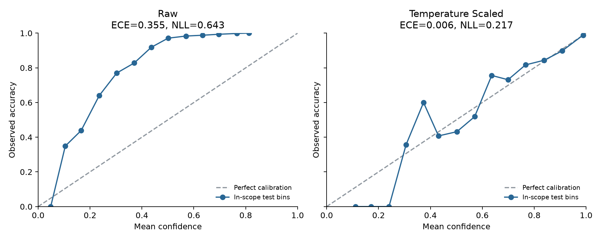

# BERT OOS 检测与置信度校准实验报告

本文件保留单 seed 阶段结果。后续已完成 seeds 42/43/44 与 typo 测试，当前汇总见 `MULTISEED_TYPO_REPORT_CN.md`。

日期：2026-10-19。基于已训练的 `bert-base-uncased`（seed=42，最佳 epoch=3）。

## 1. 这一阶段完成了什么

固定 BERT 模型，完成了 **2 种校准状态 × 3 种 OOS 分数 × 2 种阈值规则，共 12 组评估**。
所有温度和阈值都由 validation 确定，随后保存选择结果，再读取 test logits 进行评估。

结果回答了两个不同的问题：

- **校准是否有效？有效。** Test ECE 从 35.52% 降至 0.61%。
- **校准是否改善 OOS？本次没有。** 主对照实验的 OOS F1 从 66.20% 降至 63.41%。

当前结果支持进一步验证未校准 entropy 拒识，同时保留温度缩放的负结果，解释概率校准与未知意图检测之间的差异。

## 2. 实验设置

- 模型训练：15,000 条 in-scope train，150 类。
- 温度拟合：仅使用 3,000 条 in-scope validation，最小化多分类负对数似然（NLL）。
- 阈值选择：3,000 条 in-scope validation + 100 条 OOS validation。
- Test 评估：4,500 条 in-scope + 1,000 条 OOS。
- 校准状态：原始概率，以及 `softmax(logits / T)`。
- 拟合得到 **T = 0.493026**，使用预先设定的范围 `[0.05, 20]`。

三种分数均转换成“越大越像 OOS”的形式：

| 方法 | OOS 分数 |
|---|---|
| MSP | `1 − 最大类别概率` |
| Entropy | `−Σ p × ln(p)` |
| Margin | `1 − (最高概率 − 第二高概率)` |

当分数大于或等于阈值时拒识。温度缩放不改变任何样本的最高概率类别；本次已逐行验证。

两种阈值规则预先固定为：

1. **F1 规则**：最大化 validation OOS F1；并列时优先接受更多正常请求。
2. **95% 接受率规则**：在 validation 正常请求接受率至少 95% 的条件下，最大化 OOS recall。

“至少 95%”约束作用于 validation，不能保证新数据达到同一接受率。本次 test 数值均单独报告。

## 3. 校准结果：模型原本偏保守

以下均为 **in-scope test** 指标；校准指标没有混入 OOS 标签。

| 指标 | 校准前 | 校准后 |
|---|---:|---:|
| Accuracy | 95.00% | 95.00% |
| Macro-F1 | 94.98% | 94.98% |
| 平均最高概率 | 59.50% | 94.93% |
| ECE（15 个等宽区间，越低越好） | 35.52% | 0.61% |
| NLL（越低越好） | 0.6426 | 0.2167 |
| Multiclass Brier（越低越好） | 0.2168 | 0.0784 |

Brier 使用各类别误差平方之和，再对样本求平均，没有除以类别数。

模型实际正确率约为 95%，但原始平均置信度只有约 59.5%，说明该 checkpoint 明显低估自己的正确率。
因此拟合出的温度小于 1，使预测分布变尖，而不是通常直觉中的“降低过度自信”。

曲线按置信度分箱；低置信度箱可能只有少量样本，不能仅凭局部折线作过度解释。每箱样本量见同目录 `calibration_bins_test_*.csv`。

## 4. OOS 结果：校准没有带来检测收益

### 4.1 Validation OOS F1 最大的阈值

下表指标均来自 test，阈值只由 validation 选择。

| 校准状态 | 分数 | OOS Precision | OOS Recall | OOS F1 | 正常请求接受率 | AUROC |
|---|---|---:|---:|---:|---:|---:|
| 原始 | MSP | 90.47% | 52.20% | 66.20% | 98.78% | 94.68% |
| 原始 | Entropy | 90.19% | 71.70% | 79.89% | 98.27% | 95.47% |
| 原始 | Margin | 78.87% | 57.10% | 66.24% | 96.60% | 93.13% |
| 温度缩放 | MSP | 84.90% | 50.60% | 63.41% | 98.00% | 92.39% |
| 温度缩放 | Entropy | 90.67% | 48.60% | 63.28% | 98.89% | 93.63% |
| 温度缩放 | Margin | 74.70% | 50.20% | 60.05% | 96.22% | 91.20% |

主对照预先指定为 **MSP 校准前后**。OOS F1 变化为 **−2.79 个百分点**。
对固定模型及固定阈值进行 2,000 次分层配对 bootstrap，差值的 95% 区间为
**[−4.46, −1.07] 个百分点**。该区间仅描述当前 test 样本抽样的不确定性，
不包含重新训练、temperature 拟合或阈值选择的不确定性。

### 4.2 Validation 正常请求接受率至少 95% 的阈值

| 校准状态 | 分数 | OOS Precision | OOS Recall | OOS F1 | Test 正常请求接受率 |
|---|---|---:|---:|---:|---:|
| 原始 | MSP | 78.86% | 81.70% | 80.26% | 95.13% |
| 原始 | Entropy | 79.46% | 85.10% | 82.18% | 95.11% |
| 原始 | Margin | 77.53% | 66.60% | 71.65% | 95.71% |
| 温度缩放 | MSP | 76.38% | 65.00% | 70.23% | 95.53% |
| 温度缩放 | Entropy | 78.32% | 77.30% | 77.81% | 95.24% |
| 温度缩放 | Margin | 73.71% | 55.80% | 63.52% | 95.58% |

原始 Entropy 也在 validation 的 F1 规则下获得六个“校准状态/分数”组合中最高的 F1（59.83%），
因此它的后续验证有 validation 依据。不能因为某个 test 单元格更高，就重新选择阈值或宣称普遍最优。

原始 Entropy 的两个阈值体现了明确取舍：

- F1 规则：识别 **717/1,000** 条 OOS，错误拒绝 **78/4,500** 条正常输入。
- 95% 接受率规则：识别 **851/1,000** 条 OOS，错误拒绝 **220/4,500** 条正常输入。

后者多识别 134 条 OOS，同时多拒绝 142 条正常输入。是否值得，取决于应用对两种错误的成本。

## 5. 为什么校准好了，OOS 却变差？

温度缩放优化的目标是“已知意图预测的置信度是否匹配正确率”，并没有使用 OOS 来优化两个群体的分离。
本次温度缩放提高了正常输入的置信度，也提高了 OOS 输入的置信度：OOS 平均 MSP 从 18.56% 升至 54.09%。
后者会使部分未知请求更像正常请求。

三种分数的 test AUROC 在温度缩放后均下降，说明变化还涉及跨样本排序，而不只是阈值的数值发生变化。
温度缩放保持每条文本内部的类别排名，但不保证不同文本之间的 MSP、熵或 margin 排名保持不变。

这些现象支持本次 checkpoint 上“校准改善没有转化成 OOS 改善”的结论；具体机制仍需多 seed 与更多错误案例验证。

Validation OOS 占比为 3.23%，test 为 18.18%。Precision 和 F1 依赖这一比例，
所以 validation F1 最优阈值未必适合另一种部署比例；也不能直接用两个 split 的 F1 高低判断泛化改善。

## 6. 验证与产物

6 项数学边界测试通过，包括阈值相等时的处理、95% 接受率约束、已知合成温度恢复和 softmax 数值稳定性。
独立验证程序通过以下检查：

- 原始 logits 哈希未改变，metadata 逐行对应官方 JSON。
- 12 组 validation/test precision、recall、F1 和接受率与 sklearn 独立复算一致。
- AUROC、AUPR、NLL 和 ECE 一致；拟合温度处的目标梯度接近零。

产物位于 `outputs/oos/seed42/`：

- `oos_results.csv`：12 组指标和阈值。
- `calibration_metrics.csv`：校准前后指标。
- `protocol.json` / `frozen_validation_decisions.json`：实验规则和已冻结的 validation 选择。
- `paired_bootstrap.json`：主对照差值置信区间。
- `validation_scores.csv` / `test_scores.csv`：逐样本分数。
- `primary_errors_*.csv`：MSP 主对照的错误样本，供后续人工分析；本阶段没有宣称完成 60 例人工编码。
- `reliability_test.png`、`oos_roc_pr_test.png`、`validation_tradeoffs.png`、`test_confidence_distributions.png`。

## 7. 对大作业的意义与下一步

本阶段已形成完整的 OOS 对照与校准受控实验，但当前只有一个正式训练 seed。
Validation 校准指标是温度拟合数据上的结果，应把 test 校准指标作为主要证据。
已完成的实验不应描述为完成全部大作业或保证高分。

下一步按原定协议完成 BERT 超参数搜索与最终配置的 3-seed 验证，同时准备确定性 typo 测试。
主报告应继续保留预先指定的 MSP 校准前后对照，entropy 作为 validation 支持的候选方法。
随后完成至少 60 例错误编码、重复文本敏感性分析和可行的 paraphrase 检查。
后续调参继续只看 validation，避免根据本次 test 错误修改模型。

方法参考：[Guo et al., 2017：Temperature Scaling](https://proceedings.mlr.press/v70/guo17a.html)；
[Hendrycks & Gimpel, 2017：Maximum Softmax Probability](https://arxiv.org/abs/1610.02136)。
